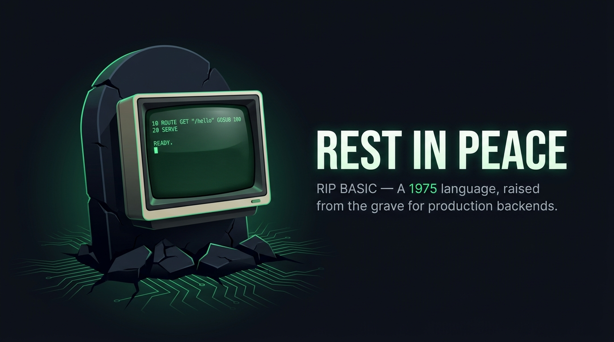
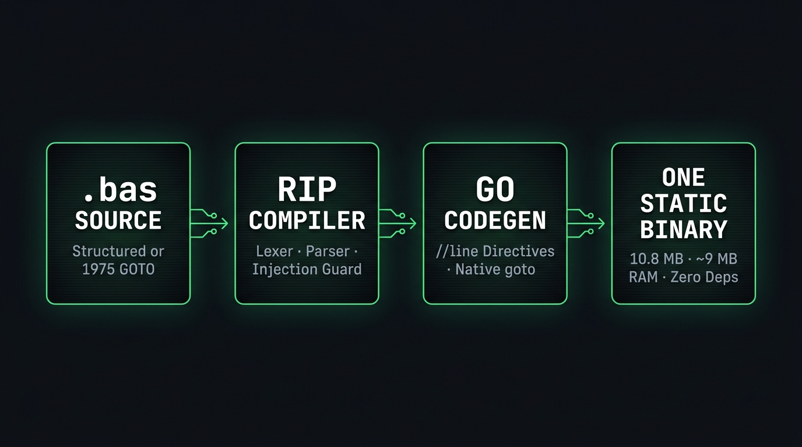

<p align="center">
  
</p>

<p align="center">
  <a href="https://go.dev/dl/"></a>
  
  
  
  <a href="LICENSE"></a>
</p>

<p align="center">
  <a href="#-30-second-quick-start">Quick Start</a> ·
  <a href="#-why-its-not-a-toy">Feature Tour</a> ·
  <a href="#-how-it-works">Architecture</a> ·
  <a href="#-real-apis-you-can-run-today">Examples</a> ·
  <a href="#-benchmarks">Benchmarks</a> ·
  <a href="#-built-with-kiro-kiroween-2026">Built with Kiro</a> ·
  <a href="docs/language.md">Language Reference</a>
</p>

---

**RIP BASIC** resurrects 1975 BASIC as a **production backend language**. It compiles straight to **Go** and ships as **one static native binary** — ~9 MiB idle RAM, goroutines under the hood, Postgres/SQLite transactions, exact `DECIMAL` money math, any Go package, and **zero Go stack traces**.

Write clean structured BASIC — **or 1975 line-numbered `GOTO` BASIC** (which compiles to real native Go `goto`):

<table>
<tr>
<th width="50%">Modern Structured Mode</th>
<th width="50%">1975 Classic Mode (real Go <code>goto</code>)</th>
</tr>
<tr>
<td>

```basic
ROUTE GET "/hello" CALL Hello
SERVE

FUNCTION Hello(req)
  RETURN {"message": "HELLO WORLD"}
END FUNCTION
```

</td>
<td>

```basic
10 ROUTE GET "/hello" GOSUB 100
20 SERVE
100 RESPOND 200, {"message": "HELLO WORLD"}
```

</td>
</tr>
</table>

---

## ⚡ 30-Second Quick Start

Requires [Go 1.26+](https://go.dev/dl/) to compile; the resulting binaries have **zero runtime dependencies**.

```sh
go install github.com/Emmanuelmelvin/rest-in-peace/cmd/rip@latest

rip new shop && cd shop
rip dev                       # READY. listening on :8080 (auto-rebuilds on save)
curl localhost:8080/hello     # {"message":"HELLO WORLD"}
rip test                      # runs tests/*.test.bas against SQLite :memory:
rip build                     # dist/shop — one ~11 MB static binary
```

From a local clone:

```sh
go run ./cmd/rip run examples/hello.bas
go test ./...
```

---

## 🪦 Why It's Not a Toy

### 1. Routes, JSON & First-Class HTTP Errors
Handlers receive `req` and return values directly as JSON. Any `HTTPERROR` that escapes a handler becomes the HTTP response; unexpected crashes return `500` with a `requestId` and never leak internals.

```basic
ROUTE GET  "/graves/:id" CALL GetGrave
ROUTE POST "/graves"     CALL Dig
SERVE

FUNCTION GetGrave(req)
  IF req.params.id <> "13" THEN THROW HTTPERROR(404, "GRAVE IS EMPTY")
  RETURN {"id": req.params.id, "name": "VLAD"}
END FUNCTION

FUNCTION Dig(req)
  IF req.body.name = NIL THEN THROW HTTPERROR(422, "A GRAVE NEEDS A NAME")
  RESPOND 201, {"name": req.body.name}, {"location": "/graves/13"}
END FUNCTION
```

### 2. Exact `DECIMAL` Money Math
Floats break billing (`0.1 + 0.2 != 0.3`). `DECIMAL` is exact fixed-point math backed by `shopspring/decimal`, and serializes to JSON as a scale-preserving string (`"64.47"`).

```basic
LET subtotal = DECIMAL("19.99") * 3
LET tax      = ROUND(subtotal * DECIMAL("0.075"), 2)
PRINT subtotal + tax          ' 64.47
```

### 3. Postgres & SQLite, `TRANSACTION`, and a Compile-Time SQL Injection Guard
Placeholders are always `$1, $2…` on both Postgres and SQLite. A `TRANSACTION` commits automatically on exit and rolls back if any error escapes — even from nested function calls. Concatenating `req.*` input into SQL triggers a **compile-time taint warning**.

```basic
DBCONNECT ENV("DATABASE_URL", "sqlite://:memory:")

TRANSACTION
  SQLEXEC("INSERT INTO souls (name) VALUES ($1)", "Casper")
  SQLEXEC("INSERT INTO souls (name) VALUES ($1)", "Vlad")
END TRANSACTION

FOR EACH soul IN SQL("SELECT name FROM souls")
  PRINT soul.name
NEXT
```

### 4. Import Any Go Package
Need UUIDs, URL parsing, bcrypt, or Stripe? Pull any Go stdlib or third-party package straight into BASIC. Go errors automatically become catchable BASIC errors (`e.kind = "GO"`).

```basic
IMPORT strings FROM GO "strings"
IMPORT uuid    FROM GO "github.com/google/uuid"

PRINT strings.ToUpper("rest in peace")
PRINT uuid.NewString()
```

### 5. Production Middleware & Secret-Redacting Logs
Built-in `APIKEY` (constant-time comparison), `BEARERJWT` (HS256 + expiration), `RATELIMIT`, `CORS`, and `REQUESTLOG`. Structured JSON `LOG` automatically redacts `password`, `token`, `apiKey`, `authorization`, and `secret` keys at any nesting depth.

```basic
USE REQUESTLOG()
USE CORS({"origins": ENV("CORS_ORIGIN", "*")})
USE RATELIMIT(120)
USE APIKEY("API_KEY") ON "/v1/*"
```

### 6. Errors in BASIC — Never a Go Stack Trace
Every statement emits a Go `//line file.bas:N` directive, so compile errors and runtime errors always point to your `.bas` file and line — with actionable hints and zero source maps.

```text
?SYNTAX ERROR IN main.bas:1 — expected THEN after IF condition
?NIL ACCESS ERROR IN main.bas:2 — cannot read "name" of NIL — check the value exists before using it
?INJECTION RISK WARNING IN main.bas:5 — use $1 placeholders
508 {"error": "TRAPPED IN AN ETERNAL GOTO LOOP"}
```

---

## ⚙️ How It Works

<p align="center">
   RIP Compiler -> Go Codegen -> One Static Binary" width="100%" />
</p>

- **Single Go package output:** All reachable `.bas` modules compile into one `package main` + an embedded runtime (`rt/`) shipped inside the `rip` CLI.
- **Native Go speed where it counts:** Typed declarations (`DIM n AS INTEGER`) compile to native Go types; untyped values use lightweight runtime helpers.
- **Zero-overhead `//line` mapping:** Every BASIC statement maps directly to its `.bas` file and line number in the Go binary — no source maps needed.
- **Real concurrency:** Every HTTP request runs on its own goroutine. Classic line-numbered handlers serialize safely around shared globals, and the hosted playground enforces a 128 MB memory cap, 5-second timeout, and loop guards.

Deep dive in [`.kiro/specs/rip-basic/design.md`](.kiro/specs/rip-basic/design.md).

---

## 🚀 Real APIs You Can Run Today

| Example | What it showcases | Run it |
|---|---|---|
| **[`examples/invoicing`](examples/invoicing)** | Full invoicing API: exact `DECIMAL` math, Postgres `TRANSACTION`, `APIKEY` auth, `migrations/`, `rip test`, distroless `Dockerfile` | `cd examples/invoicing && rip test` |
| **[`examples/url-shortener`](examples/url-shortener)** | Production URL shortener: `302` redirects, atomic click analytics, Go `net/url` & `regexp` interop, `RATELIMIT`, distroless `Dockerfile` | `cd examples/url-shortener && rip test` |
| **[`examples/classic-todo.bas`](examples/classic-todo.bas)** | Full CRUD REST API written in 1975 line-numbered `GOSUB`/`GOTO` BASIC | `rip run examples/classic-todo.bas` |
| **[`examples/goto-hell.bas`](examples/goto-hell.bas)** | An infinite `GOTO` loop — demonstrates the `508 TRAPPED IN AN ETERNAL GOTO LOOP` safety guard | `rip run examples/goto-hell.bas` |

In-process HTTP + unit tests live right in `tests/*.test.bas` — no mocks, no external test runner:

```basic
TEST "FULL SHORTEN, REDIRECT, AND ANALYTICS FLOW"
  LET hdrs = {"x-api-key": "test-key"}
  LET created = REQUEST("POST", "/api/links", {"url": "https://example.com/docs"}, hdrs)
  EXPECT created.status = 201

  LET redir = REQUEST("GET", "/r/" & created.body.code)
  EXPECT redir.status = 302
  EXPECT redir.headers["location"] = "https://example.com/docs"
END TEST
```

---

## 📊 Benchmarks

Measured against an equivalent hand-written Go `net/http` baseline (`GOMAXPROCS=1`, 64 concurrent keep-alive connections, `examples/hello.bas` compiled with `rip build`):

| Metric | RIP BASIC (`hello.bas`) | Plain Go `net/http` | Spec Target |
|---|---:|---:|---|
| **Static binary size** | **10.78 MiB** | 6.50 MiB | `<= 30 MB` ✅ |
| **Idle memory (RSS)** | **8.93 MiB** | 8.02 MiB | `<= 20 MB` ✅ |
| **Throughput (`GOMAXPROCS=1`)** | **6,668.7 req/s** | 6,414.7 req/s | Matches Go `net/http` |
| **Errors (66,740 requests)** | **0** | 0 | `0` ✅ |

Full reproducible setup, multi-core runs, and honest caveats (Windows loopback limits & Go heap scavenging) are documented in [`docs/benchmarks.md`](docs/benchmarks.md).

---

## 🎃 Built with Kiro (Kiroween 2026)

REST in Peace was built end-to-end with a **spec-driven `.kiro/` workflow**:

- **Specs:** [`.kiro/specs/rip-basic/requirements.md`](.kiro/specs/rip-basic/requirements.md) (16 EARS requirements), [`design.md`](.kiro/specs/rip-basic/design.md), and [`tasks.md`](.kiro/specs/rip-basic/tasks.md).
- **Steering:** [`.kiro/steering/`](.kiro/steering) locks down language grammar, security rules (constant-time auth, HS256-only JWT, log redaction, taint analysis), and code ownership.
- **Hooks:** Automated checks run golden tests, `rip check`, and example suites on save.
- **Built directly in Kiro:** Built-in middleware (`APIKEY`, `CORS`, `REQUESTLOG`, `RATELIMIT`, `BEARERJWT`), `ENV`/`LOG` with recursive secret redaction, `DECIMAL`/`ROUND`, `rip migrate`, compile-time SQL injection taint analysis, `FETCH` outbound HTTP, and the CRT playground theme.

Read the full engineering log in [`docs/kiro.md`](docs/kiro.md).

---

<details>
<summary><strong>🛠️ CLI Command Reference</strong></summary>

| Command | Does |
|---|---|
| `rip new <name>` | Scaffold a project (`main.bas`, `rip.json`, `migrations/`, `tests/`, `.env.example`, `Dockerfile`, `.kiro/`) |
| `rip dev [file.bas]` | Compile and run, automatically rebuilding and restarting on file save |
| `rip run [file.bas]` | Compile and run once |
| `rip test` | Run `tests/*.test.bas` against SQLite `:memory:` (or `TEST_DATABASE_URL`) |
| `rip build [--os X] [--arch Y] [-o file]` | Cross-compile one static binary in `dist/` |
| `rip migrate` | Apply `migrations/*.sql` in order, tracked in `_rip_migrations` |
| `rip check [file.bas]` | Compile-check only; print errors and warnings (including SQL injection risks) |

</details>

<details>
<summary><strong>📁 Repository Layout</strong></summary>

| Path | What |
|---|---|
| `.kiro/` | Kiro specs, steering files, and hooks |
| `cmd/rip`, `internal/cli` | The `rip` CLI (`new`, `dev`, `run`, `test`, `build`, `migrate`, `check`) |
| `internal/compiler` | Lexer, parser, AST, semantic & injection checks, Go codegen, Go interop |
| `internal/build` | Build pipeline, embedded runtime, `go.mod` resolution, `go build` |
| `rt/` | Runtime linked into every compiled binary (HTTP, SQL, middleware, `DECIMAL`, `FETCH`, `LOG`) |
| `cmd/playground`, `internal/playground`, `playground/web` | Hosted CRT playground with live SSE logs and loop/memory sandboxing |
| `examples/` | [`invoicing/`](examples/invoicing), [`url-shortener/`](examples/url-shortener), [`classic-todo.bas`](examples/classic-todo.bas), [`goto-hell.bas`](examples/goto-hell.bas), [`hello.bas`](examples/hello.bas) |
| `bench/` | Reproducible throughput, RSS, and binary-size benchmark harness |
| `testdata/golden` | End-to-end golden compiler & runtime tests |
| `docs/` | [`language.md`](docs/language.md), [`benchmarks.md`](docs/benchmarks.md), [`kiro.md`](docs/kiro.md) |

</details>

---

<p align="center">
  <strong>MIT Licensed</strong> · Built for <strong>Kiroween 2026</strong> · <code>READY.</code>
</p>
